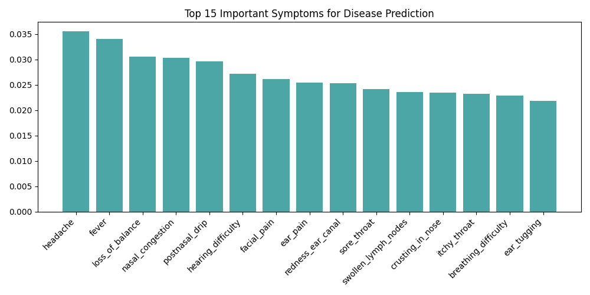

# 🩺 ENT Disease Prediction System

An AI-powered **ENT (Ear, Nose, and Throat) Disease Prediction System** built using Python and Machine Learning. The application analyzes user-reported symptoms to predict possible diseases and provides relevant disease descriptions, precautions, and medicine-related information.

## 📌 Project Overview

The ENT Disease Prediction System uses a machine learning model trained on symptom-based data to identify potential diseases based on the symptoms selected by the user.

The project combines machine learning, data preprocessing, and an interactive Python-based user interface to make preliminary disease prediction more accessible.

## ✨ Features

- 🤖 **Disease Prediction:** Predicts possible diseases based on user-selected symptoms.
- 🩺 **Symptom Analysis:** Processes symptoms as input for the trained ML model.
- 📋 **Disease Information:** Provides descriptions of predicted diseases.
- 💊 **Medicine Information:** Includes a medicine dataset for reference.
- ⚠️ **Precaution Recommendations:** Displays precautions associated with diseases.
- 📊 **Feature Importance Visualization:** Includes a visualization of important prediction features.
- 🖥️ **Interactive Interface:** Provides a user interface built with Python.

## 🛠️ Tech Stack

- **Programming Language:** Python
- **Machine Learning:** Scikit-learn (if used to train the saved model)
- **Data Processing:** Pandas, NumPy (if used in preprocessing)
- **User Interface:** Python-based UI using `app_ui.py`
- **Model Storage:** Pickle (`.pkl`)
- **Dataset Format:** CSV

## 📂 Project Structure

```text
ENT-Disease-Prediction/
│
├── app_ui.py                  # Application user interface
├── t.py                       # Supporting Python script
├── Symptom-severity.csv       # Symptom severity data
├── cleaned_dataset.csv        # Cleaned dataset for training/prediction
├── disease_description.csv    # Disease descriptions
├── medicine.csv               # Medicine-related information
├── symptom_precaution.csv     # Disease precautions
├── symptom_list.pkl           # Serialized symptom list
├── model.pkl                  # Trained machine learning model
├── feature_importance.png     # Feature importance visualization
└── README.md                  # Project documentation
```

## ⚙️ Installation and Setup

### 1. Clone the Repository

```bash
git clone https://github.com/tsukishima07/ENT-Disease-Prediction.git
```

### 2. Navigate to the Project Directory

```bash
cd ENT-Disease-Prediction
```

### 3. Create a Virtual Environment (Recommended)

```bash
python -m venv venv
```

Activate the environment on Windows:

```bash
venv\Scripts\activate
```

### 4. Install Dependencies

Install the libraries required by your project:

```bash
pip install pandas numpy scikit-learn
```

If the application uses additional libraries, install them as well. If a `requirements.txt` file is available, use:

```bash
pip install -r requirements.txt
```

### 5. Run the Application

```bash
python app_ui.py
```

Follow the instructions displayed by the application to enter symptoms and view the prediction.

## 🔍 How It Works

1. **Input Symptoms:** The user selects or enters symptoms.
2. **Data Processing:** The application converts the symptoms into the format expected by the trained model.
3. **Disease Prediction:** The saved machine learning model predicts a possible disease.
4. **Information Retrieval:** The application retrieves the corresponding disease description, precautions, and available medicine information.
5. **Result Display:** The predicted result and associated information are presented through the user interface.

## 📊 Feature Importance

The repository includes `feature_importance.png`, which visualizes the relative importance of features used by the model, if generated during model training.



## 🎯 Project Objectives

- Develop a machine learning-based system for symptom-driven disease prediction.
- Simplify access to relevant disease information.
- Integrate prediction results with disease descriptions and precautionary information.
- Demonstrate the practical application of machine learning in healthcare.

## 🔮 Future Enhancements

- Improve prediction accuracy using larger and more diverse datasets.
- Develop a web-based interface using Flask, FastAPI, or Streamlit.
- Add user authentication and prediction history.
- Improve symptom validation and error handling.
- Deploy the application to a cloud platform.
- Add medically reviewed information and clearer recommendations for seeking professional care.

## ⚠️ Disclaimer

This project is intended for **educational and informational purposes only**. Predictions are not a medical diagnosis and should not replace professional medical advice, examination, or treatment. Medicine and precaution information should be verified by qualified healthcare professionals before use.

## 👨‍💻 Author

**Vamsi Krishna**

GitHub: [@tsukishima07](https://github.com/tsukishima07)

---

⭐ If you find this project interesting, consider giving the repository a star!
